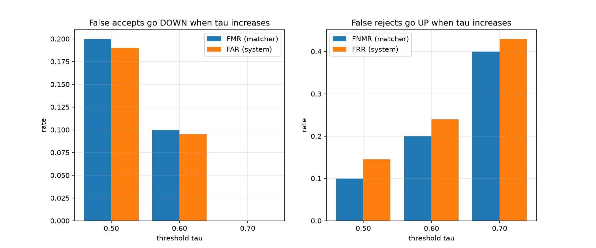
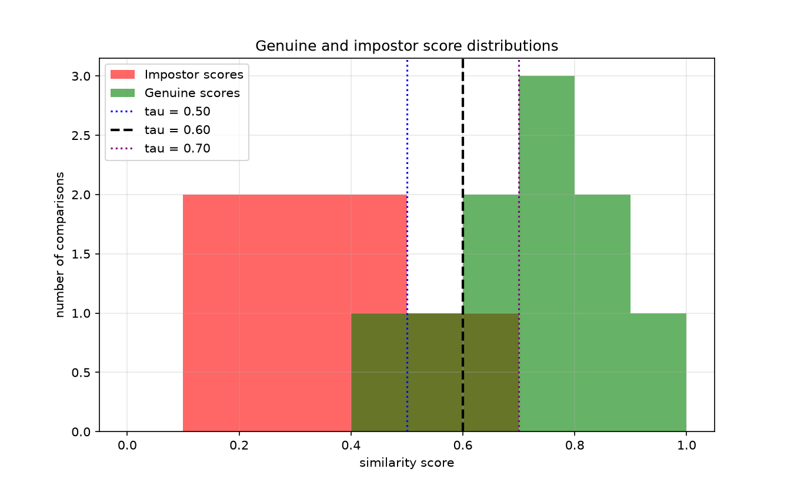
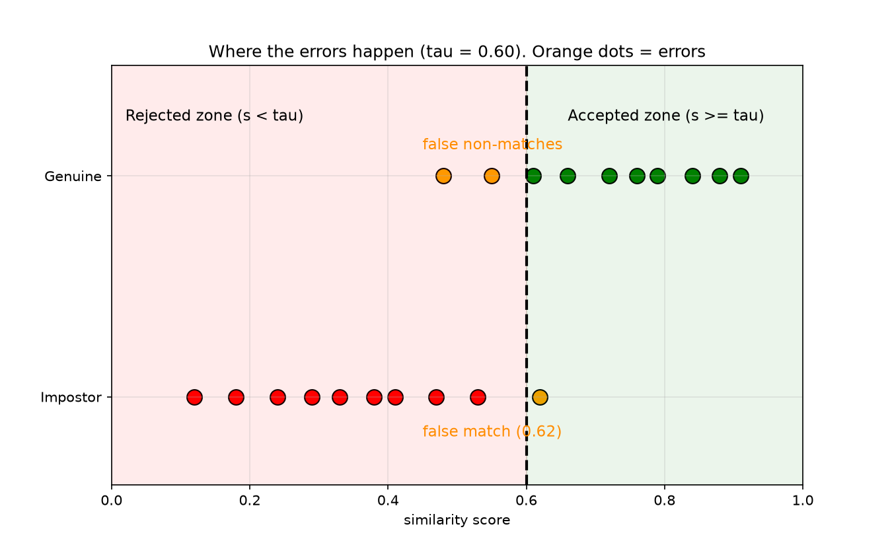
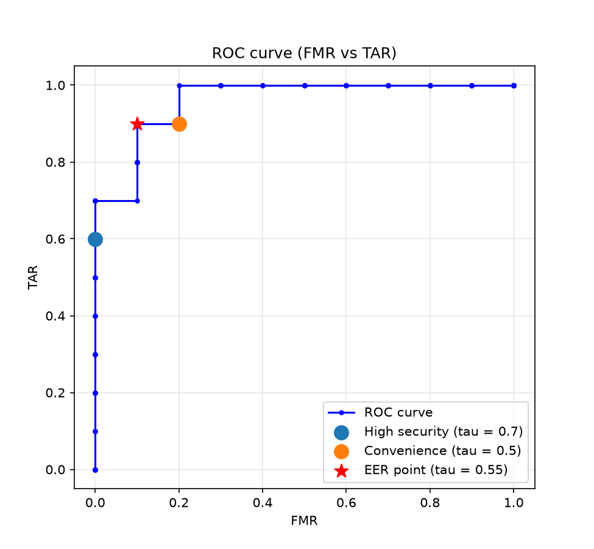
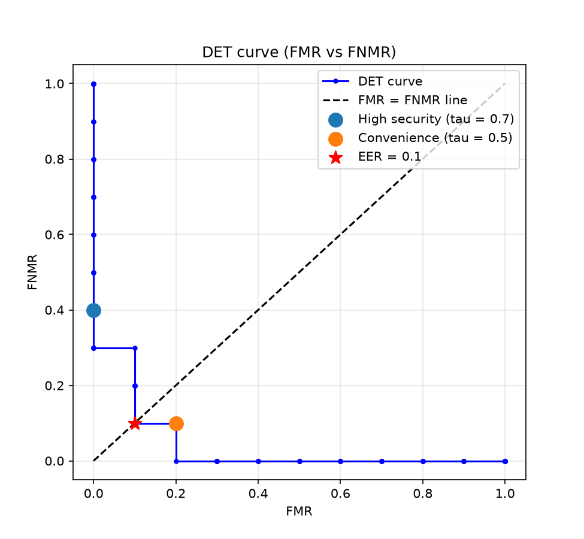
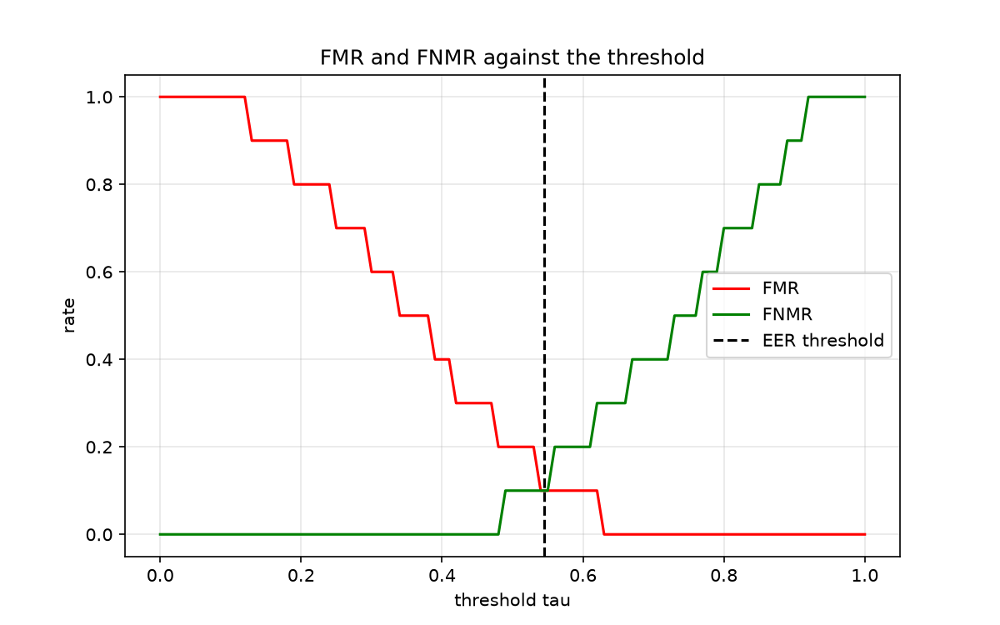

# Evaluation of a Biometric Verification System

Short report and code for the assignment *Evaluation of a biometric verification system*.

The complete evaluation chain:

```
Acquisition -> Matcher scores -> Threshold -> Match / non-match decisions
-> Matcher-level metrics -> System-level performance
```

## Project structure

```
biometric_eval/
├── main.py                  # menu: choose which part to run
├── data.py                  # the scores, FTA and the function that computes all metrics
├── part1_calculations.py    # Questions 1-4: metrics for 3 thresholds + table
├── part2_distributions.py   # Question 5: score distributions
├── part3_curves.py          # Questions 6-8: ROC, DET, EER, operating points
├── README.md                # this report (Questions 9-10 and interpretation)
└── plots/                   # created automatically (part1, part2, part3)
```

## How to run

```bash
pip install numpy matplotlib
cd biometric_eval
python main.py
```

Choose `1`, `2`, `3` or `all` in the menu (`q` to quit).

---

## Data

- Decision rule: **match if s >= tau**
- Genuine scores: 0.91, 0.88, 0.84, 0.79, 0.76, 0.72, 0.66, 0.61, 0.55, 0.48
- Impostor scores: 0.62, 0.53, 0.47, 0.41, 0.38, 0.33, 0.29, 0.24, 0.18, 0.12
- FTA = 5% (an acquisition failure counts as a rejection)
- System level: `FAR = (1 - FTA) x FMR` and `FRR = FTA + (1 - FTA) x FNMR`

---

## 1. Threshold tau = 0.60

**a. Genuine comparisons rejected:** 0.55 and 0.48 (2 out of 10). These are false non-matches: a real person is refused.

**b. Impostor comparisons accepted:** 0.62 (1 out of 10). This is a false match: an impostor gets in.

**c. Matcher-level metrics**

| Metric | Calculation | Value | Meaning |
|---|---|---|---|
| FMR | 1 / 10 | **0.10** | 10% of impostor comparisons are wrongly accepted |
| FNMR | 2 / 10 | **0.20** | 20% of genuine comparisons are wrongly rejected |
| TAR | 1 - 0.20 | **0.80** | 80% of genuine users are correctly accepted |
| TRR | 1 - 0.10 | **0.90** | 90% of impostors are correctly rejected |

## 2. System-level metrics (FTA = 5%)

| Metric | Calculation | Value |
|---|---|---|
| FAR | 0.95 x 0.10 | **0.095** (9.5%) |
| FRR | 0.05 + 0.95 x 0.20 | **0.24** (24%) |

**Matcher level vs system level.** FMR, FNMR, TAR and TRR only look at the comparisons that the matcher actually received, so they ignore users who could not even give a usable sample. FAR and FRR describe the **whole transaction**, including the acquisition step.

- FAR is a bit **smaller** than FMR, because some impostors are stopped before the matcher (failure to acquire).
- FRR is **larger** than FNMR, because a person who fails to acquire is rejected too. Here, 5% of genuine users are rejected at the sensor, plus 19% (0.95 x 0.20) rejected by the matcher, giving 24% in total.

## 3. Thresholds 0.50 and 0.70

**tau = 0.50:** the rejected genuine score is 0.48. The accepted impostor scores are 0.62 and 0.53.

**tau = 0.70:** the rejected genuine scores are 0.66, 0.61, 0.55 and 0.48. No impostor is accepted (the highest impostor score is 0.62).

## 4. Comparison table

| tau | FMR | FNMR | TAR | TRR | FAR | FRR |
|---|---|---|---|---|---|---|
| **0.50** | 0.20 | 0.10 | 0.90 | 0.80 | 0.190 | 0.145 |
| **0.60** | 0.10 | 0.20 | 0.80 | 0.90 | 0.095 | 0.240 |
| **0.70** | 0.00 | 0.40 | 0.60 | 1.00 | 0.000 | 0.430 |



**Effect of increasing the threshold**

- **FMR / FAR go down** (0.20 -> 0.10 -> 0.00). The system asks for a higher similarity, so fewer impostors pass.
- **FNMR / FRR go up** (0.10 -> 0.20 -> 0.40, and 14.5% -> 24% -> 43% at system level). The system also asks more from real users, so more of them are refused.

**Security vs convenience.** A high threshold gives more security (few intruders) but less convenience (many honest users must retry or are blocked). A low threshold is the opposite: easy for users, but easier to attack. We cannot lower both errors at the same time by moving the threshold, we can only choose the compromise. Only a better matcher can reduce both.

## 5. Score distributions





- **Genuine scores** are mostly high (0.48 to 0.91). **Impostor scores** are mostly low (0.12 to 0.62).
- **False matches** happen on the **right** of the threshold, where impostor scores are above tau (here 0.62).
- **False non-matches** happen on the **left** of the threshold, where genuine scores are below tau (here 0.55 and 0.48).
- **Why the overlap creates errors:** the two distributions overlap between 0.48 and 0.62. In this zone, some genuine comparisons look like impostors and some impostor comparisons look like genuine ones. Any threshold placed in this zone has to make a mistake on one side. Only a threshold outside the overlap would give zero errors on one side, but then the other side pays for it.

## 6. ROC and DET curves

The threshold was swept from 0 to 1 in steps of 0.01.







- **ROC (FMR vs TAR):** a good system goes quickly to the top left (low FMR, high TAR). Our curve reaches TAR = 0.9 at FMR = 0.2, and TAR = 1.0 only when FMR = 0.3.
- **DET (FMR vs FNMR):** a good system is close to the bottom left corner (both errors low). Moving along the curve shows the trade-off: a lower FMR always costs a higher FNMR.

## 7. Equal Error Rate (EER)

| Result | Value |
|---|---|
| Threshold where FMR = FNMR | between 0.54 and 0.55 (estimated **tau = 0.545**) |
| FMR | 0.10 |
| FNMR | 0.10 |
| **EER** | **10%** |

**Meaning:** at this threshold the system makes as many false accepts as false rejects (10% each). The EER is a single number to compare systems: the lower it is, the better the matcher. It does not say which threshold to use in a real application.

## 8. Operating thresholds

| Application | Threshold | FMR | FNMR | FAR | FRR |
|---|---|---|---|---|---|
| **High security** | **0.70** | 0.00 | 0.40 | 0.000 | 0.430 |
| **Convenience** | **0.50** | 0.20 | 0.10 | 0.190 | 0.145 |

**a. High-security access: tau = 0.70.** No impostor is accepted (FMR = FAR = 0), and the threshold keeps a safety margin of 0.08 above the best impostor score (0.62). The price is a high rejection rate (FRR = 43%), which is acceptable because users can retry or use a second factor. With only 10 impostor scores, FMR = 0 does not prove the real FMR is zero, so a margin is wise.

**b. Convenience-oriented authentication: tau = 0.50.** Only 14.5% of real attempts are rejected (FRR), and 90% of genuine comparisons pass (TAR). The price is that FAR = 19%, which is acceptable only when the risk of a wrong accept is small (for example, unlocking a personal gadget with other protections). A threshold of 0.48 would reject no genuine comparison in this data, but it would be too tuned to this small sample.

## 9. Why not the same threshold?

Because the **cost of the two errors is different** in each application. In a high-security place (a data centre, a bank vault), accepting one impostor can be a disaster, while rejecting a real user only costs a few seconds. In a convenience application (a phone, a gym door), repeated rejections annoy people and make them stop using the system, while a false accept has a small impact. The threshold is a business and risk decision, not a technical constant: it is set to match the application's tolerance for each type of error.

## 10. Classification of the metrics

| Metric | Evaluation level |
|---|---|
| **FTA** | Acquisition level |
| **FMR** | Matcher level |
| **FNMR** | Matcher level |
| **TAR** | Matcher level (TAR = 1 - FNMR) |
| **TRR** | Matcher level (TRR = 1 - FMR) |
| **FAR** | Transaction / system level |
| **FRR** | Transaction / system level |

---

## Short interpretation

- The matcher separates genuine and impostor scores quite well, but not perfectly: the scores overlap between 0.48 and 0.62, so errors cannot be avoided. The EER is 10%.
- Raising the threshold removes false accepts but creates false rejects. Lowering it does the opposite.
- The failure-to-acquire rate (5%) makes FRR always larger than FNMR, because acquisition failures are rejections. FAR is slightly smaller than FMR for the same reason.
- The best threshold depends on the application: high-security systems choose a high threshold (0.70), convenience systems choose a lower one (0.50).
- With only 10 genuine and 10 impostor scores, all rates move in steps of 10%. The results show the method, but a real evaluation needs many more comparisons.
